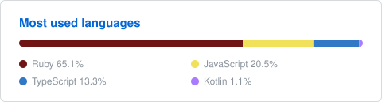

<h1 align="center">Hi! 👀   I'm Esteban 👋😊</h1>

---

I'm a Senior Software Engineer based in Medellín, Colombia. Since 2018 I've been building web platforms in Ruby on Rails for US and LatAm companies across fintech, subscription billing and logistics.

Ruby is my main language 🔻, and I work across the stack with React and TypeScript too.

AI is now a core part of how I build software: MCP servers, agent skills, and AI-driven workflows to ship features faster.

I like reading a lot, playing some video games and I also like watching some series and anime 📺.

 

### Technologies

  
   
  

 

### Currently building

- Software with quality that lasts for years, with the help of LLMs
- MCP servers
- Agent skills for Claude Code, Codex and OpenCode

 

### GitHub Stats

  
  

 

---

  
  

